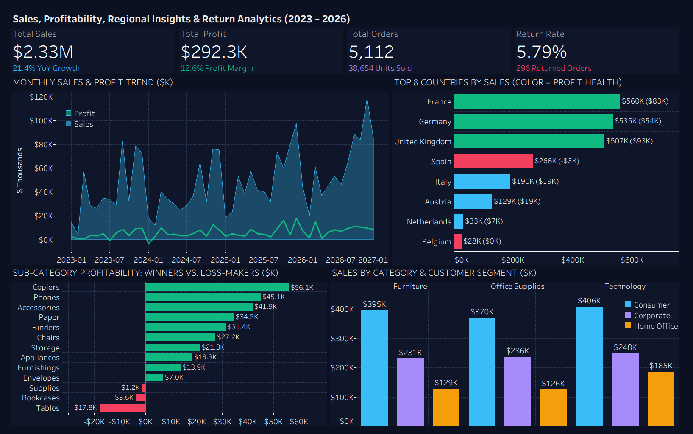

# EU Superstore Sales & Profitability Dashboard (2023–2026)

A Tableau dashboard on the Sample – EU Superstore dataset (5,112 orders, 15 countries, 2023–2026) showing sales, profit, regional performance and returns.

**Live dashboard:** https://public.tableau.com/app/profile/arjun6437/viz/EUSuperstoreSalesProfitabilityDashboard/Dashboard1

## What's in the dashboard
- **KPI cards:** Total Sales, Total Profit and margin, Total Orders and units, Return Rate, YoY growth
- **Monthly trend:** sales and profit over time
- **Top 8 countries:** sales, coloured by profit health, labelled with profit
- **Sub-category profit:** winners vs loss-makers
- **Category and segment:** sales split by customer segment

## Key numbers
- Sales 2.33M, profit 292.3K, margin 12.6%
- Sales grew 21.4% in 2026 vs 2025
- 5.79% of orders returned (296 orders)

## What I found
1. **France, Germany and the UK make about 69% of sales.** The UK is the most profitable of the three (93K profit on 507K sales). Germany earns much less on similar sales (54K on 535K).
2. **Spain is a loss-making market.** It is the 4th largest by sales (266K) but its profit is -3K. Belgium is also slightly negative.
3. **Three sub-categories lose money:** Tables (-17.8K), Bookcases (-3.6K) and Supplies (-1.2K). Tables is the biggest loss-maker and loses more than the other two combined.
4. **Copiers, Phones and Accessories earn the most profit** (56K, 45K and 42K).
5. **Consumer is the largest segment** in every category, with Corporate second and Home Office smallest.

## Suggestions
- Review pricing and discounts on Tables, Bookcases and Supplies.
- Investigate why Spain sells well but makes a loss.
- Keep growing the profitable lines (Copiers, Phones, Accessories).

## How I built it
- Calculated fields: Profit Margin, YoY Growth, Returned Orders, Return Rate, Profit Health, Profitable?
- Colour rules for loss and profit, custom number formats, dark theme
- Dashboard built with containers and floating legends

## Files
- `EU Superstore Sales & Profitability Dashboard.twbx` – Tableau workbook
- `Sample - EU Superstore.xlsx` – source data
- `dashboard.png` – screenshot

Data is a public practice dataset, not real company data.
